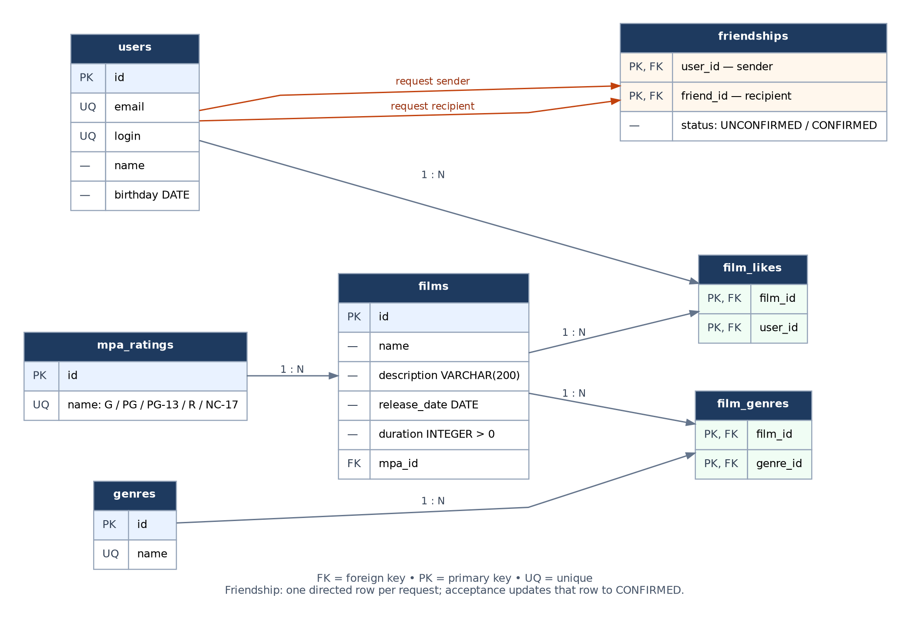

# java-filmorate
Template repository for Filmorate project.
## Database schema

The normalized relational schema is shown below. Values with multiple relationships are stored in join tables rather than arrays or comma-separated strings.



### Tables and relationships

- `users` — user profile fields. `email` and `login` are unique.
- `films` — film data and an optional foreign key to `mpa_ratings`.
- `genres` — genre dictionary.
- `mpa_ratings` — MPA dictionary (`G`, `PG`, `PG-13`, `R`, `NC-17`).
- `film_genres` — many-to-many relation between films and genres. Composite primary key `(film_id, genre_id)` prevents duplicate genre links.
- `film_likes` — many-to-many relation between users and films they like. Composite primary key `(film_id, user_id)` prevents duplicate likes.
- `friendships` — one directed request from `user_id` (sender) to `friend_id` (recipient). A request starts as `UNCONFIRMED`; when accepted, that same row changes to `CONFIRMED`. Confirmed friendship queries treat the connection as mutual even though only one row is stored.

In PostgreSQL, add checks for `films.duration > 0`, `friendships.status IN ('UNCONFIRMED', 'CONFIRMED')`, and `friendships.user_id <> friendships.friend_id`.

### Reference data

The genre and MPA dictionaries can be initialized with the following values:

```sql
INSERT INTO genres (id, name) VALUES
    (1, 'Комедия'),
    (2, 'Драма'),
    (3, 'Мультфильм'),
    (4, 'Триллер'),
    (5, 'Документальный'),
    (6, 'Боевик');

INSERT INTO mpa_ratings (id, name) VALUES
    (1, 'G'),
    (2, 'PG'),
    (3, 'PG-13'),
    (4, 'R'),
    (5, 'NC-17');
```

### Example SQL queries

The examples use PostgreSQL-style positional parameters (`$1`, `$2`, etc.).

**Create a user**

```sql
INSERT INTO users (email, login, name, birthday)
VALUES ($1, $2, $3, $4)
RETURNING id;
```

**Get all users**

```sql
SELECT id, email, login, name, birthday
FROM users
ORDER BY id;
```

**Create a film** (`$5` is an MPA ID; it may be `NULL` while the application treats MPA as optional)

```sql
INSERT INTO films (name, description, release_date, duration, mpa_id)
VALUES ($1, $2, $3, $4, $5)
RETURNING id;
```

**Get all films with MPA ratings**

```sql
SELECT f.id, f.name, f.description, f.release_date, f.duration,
       m.name AS mpa_rating
FROM films AS f
LEFT JOIN mpa_ratings AS m ON m.id = f.mpa_id
ORDER BY f.id;
```

**Get genres for one film** (`$1` is the film ID)

```sql
SELECT g.id, g.name
FROM genres AS g
JOIN film_genres AS fg ON fg.genre_id = g.id
WHERE fg.film_id = $1
ORDER BY g.id;
```

**Link a genre to a film** (`$1` is the film ID, `$2` is the genre ID)

```sql
INSERT INTO film_genres (film_id, genre_id)
VALUES ($1, $2)
ON CONFLICT (film_id, genre_id) DO NOTHING;
```

**Get the top N popular films** (`$1` is N; likes are counted per film)

```sql
SELECT f.id, f.name, COUNT(fl.user_id) AS likes_count
FROM films AS f
LEFT JOIN film_likes AS fl ON fl.film_id = f.id
GROUP BY f.id, f.name
ORDER BY likes_count DESC, f.id
LIMIT $1;
```

**Add a like** (`$1` is the film ID, `$2` is the user ID)

```sql
INSERT INTO film_likes (film_id, user_id)
VALUES ($1, $2)
ON CONFLICT (film_id, user_id) DO NOTHING;
```

**Send a friendship request** (`$1` is sender, `$2` is recipient)

```sql
INSERT INTO friendships (user_id, friend_id, status)
VALUES ($1, $2, 'UNCONFIRMED');
```

**Accept a friendship request** (`$1` is original sender, `$2` is recipient)

```sql
UPDATE friendships
SET status = 'CONFIRMED'
WHERE user_id = $1
  AND friend_id = $2
  AND status = 'UNCONFIRMED';
```

**Get confirmed friends of a user** (`$1` is the user ID)

```sql
SELECT u.id, u.email, u.login, u.name, u.birthday
FROM friendships AS fr
JOIN users AS u
  ON u.id = CASE WHEN fr.user_id = $1 THEN fr.friend_id ELSE fr.user_id END
WHERE fr.status = 'CONFIRMED'
  AND (fr.user_id = $1 OR fr.friend_id = $1)
ORDER BY u.id;
```

**Get common confirmed friends** (`$1` and `$2` are the two user IDs)

```sql
WITH friends_of_first AS (
    SELECT CASE WHEN user_id = $1 THEN friend_id ELSE user_id END AS friend_id
    FROM friendships
    WHERE status = 'CONFIRMED' AND (user_id = $1 OR friend_id = $1)
),
friends_of_second AS (
    SELECT CASE WHEN user_id = $2 THEN friend_id ELSE user_id END AS friend_id
    FROM friendships
    WHERE status = 'CONFIRMED' AND (user_id = $2 OR friend_id = $2)
)
SELECT u.id, u.email, u.login, u.name, u.birthday
FROM friends_of_first AS a
JOIN friends_of_second AS b ON b.friend_id = a.friend_id
JOIN users AS u ON u.id = a.friend_id
ORDER BY u.id;
```

**Remove a friendship from either side** (`$1` and `$2` are the two user IDs)

```sql
DELETE FROM friendships
WHERE (user_id = $1 AND friend_id = $2)
   OR (user_id = $2 AND friend_id = $1);
```

